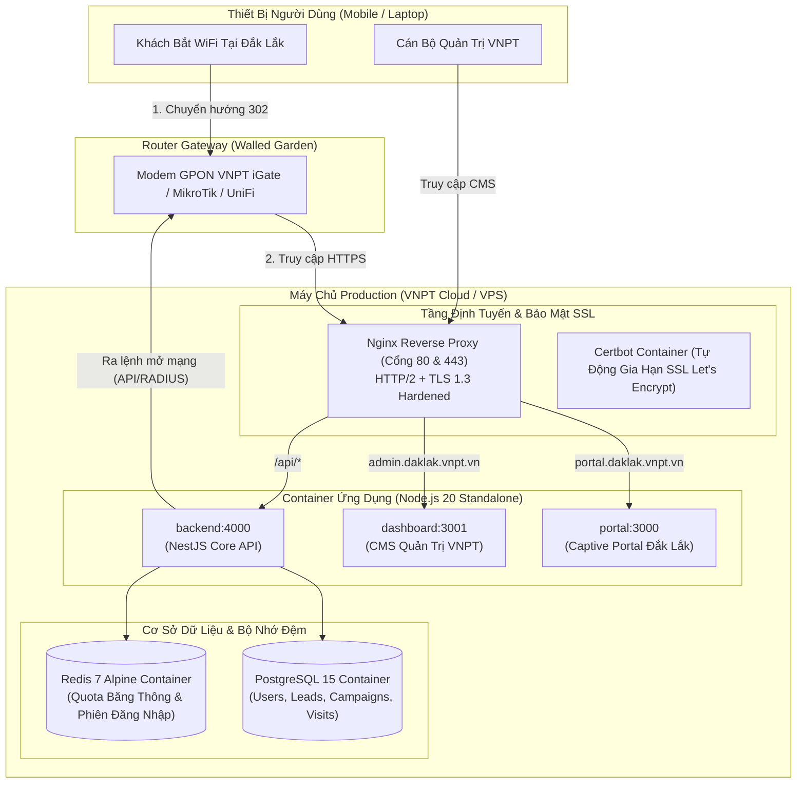

# Hướng Dẫn Triển Khai Production & Cấu Hình SSL / HTTPS
## Hệ Thống WiFi Marketing & Chuyển Đổi Số VNPT Đắk Lắk

Tài liệu hướng dẫn kỹ sư hệ thống Viễn thông Đắk Lắk (VNPT Đắk Lắk) triển khai toàn diện nền tảng trên hạ tầng máy chủ VNPT Cloud, VPS hoặc Server vật lý.

---

## 1. Kiến Trúc Môi Trường Production (Docker & Nginx SSL)



---

## 2. Yêu Cầu Cấu Hình Tên Miền & DNS (VNPT Đắk Lắk)

Cần cấu hình 2 bản ghi DNS trỏ về IP Public của máy chủ Production:

| Bản Ghi | Loại (Type) | Giá Trị (Value) | Mục Đích |
| :--- | :---: | :--- | :--- |
| `portal.daklak.vnpt.vn` | **A** | `IP_PUBLIC_SERVER` | Cổng chào đón khách Captive Portal |
| `admin.daklak.vnpt.vn` | **A** | `IP_PUBLIC_SERVER` | CMS Quản trị & Báo cáo số |

---

## 3. Danh Sách Walled Garden (Bắt Buộc Trên Router / Modem GPON)

Để điện thoại khách hàng (đặc biệt là **iOS Apple CNA** và **Android CaptivePortalLogin**) không báo lỗi bảo mật và tải được trang chào, cần thêm danh sách sau vào **Walled Garden (Whitelist)** trên Modem iGate / MikroTik:

```text
# Domain máy chủ Portal & API
portal.daklak.vnpt.vn
admin.daklak.vnpt.vn

# Domain kiểm tra mạng của hệ điều hành điện thoại
captive.apple.com
connectivitycheck.gstatic.com
connectivitycheck.android.com
msftconnecttest.com

# CDN lưu trữ hình ảnh & tài nguyên tĩnh
images.unsplash.com
cdnjs.cloudflare.com
fonts.googleapis.com
fonts.gstatic.com
```

---

## 4. Các Bước Triển Khai 1-Click (1-Click Deployment)

### Bước 1: Sao chép mã nguồn lên Server
```bash
git clone <repository_url> /opt/vnpt-wifi-marketing
cd /opt/vnpt-wifi-marketing/docker
```

### Bước 2: Cấu hình biến môi trường
Tạo file `.env.production` từ template mẫu:
```bash
cp .env.production.example .env.production
nano .env.production
```
Điền các thông số mật khẩu CSDL PostgreSQL, JWT Secret, và email quản trị.

### Bước 3: Khởi tạo chứng chỉ bảo mật SSL (Let's Encrypt)
Chạy script cấp phát chứng chỉ tự động:
```bash
chmod +x init-ssl.sh
./init-ssl.sh
```
*Script sẽ tự động khởi động Nginx tạm thời, gửi yêu cầu tới Let's Encrypt và lưu trữ chứng chỉ SSL vào thư mục `docker/certbot/conf`.*

### Bước 4: Khởi động toàn bộ cụm dịch vụ Production
```bash
chmod +x deploy.sh
./deploy.sh
```

---

## 5. Giám Sát & Quản Trị Hệ Thống Production

### Kiểm tra trạng thái các Container:
```bash
docker compose -f docker-compose.prod.yml ps
```

Kết quả chuẩn:
```text
NAME                 IMAGE                     STATUS
vnpt_wifi_postgres   postgres:15-alpine        Up (healthy)
vnpt_wifi_redis      redis:7-alpine            Up (healthy)
vnpt_wifi_backend    docker-backend:latest     Up
vnpt_wifi_portal     docker-portal:latest      Up
vnpt_wifi_dashboard  docker-dashboard:latest   Up
vnpt_wifi_nginx      nginx:alpine              Up (ports 80, 443)
vnpt_wifi_certbot    certbot/certbot:latest    Up
```

### Xem nhật ký hoạt động (Logs):
```bash
# Xem log Nginx tiếp nhận yêu cầu từ du khách
docker compose -f docker-compose.prod.yml logs -f nginx

# Xem log Backend cấp quyền Internet
docker compose -f docker-compose.prod.yml logs -f backend
```

### Sao lưu (Backup) Cơ sở dữ liệu định kỳ:
```bash
docker compose -f docker-compose.prod.yml exec postgres pg_dump -U vnpt_admin vnpt_wifi_marketing > backup_$(date +%Y%m%d).sql
```
